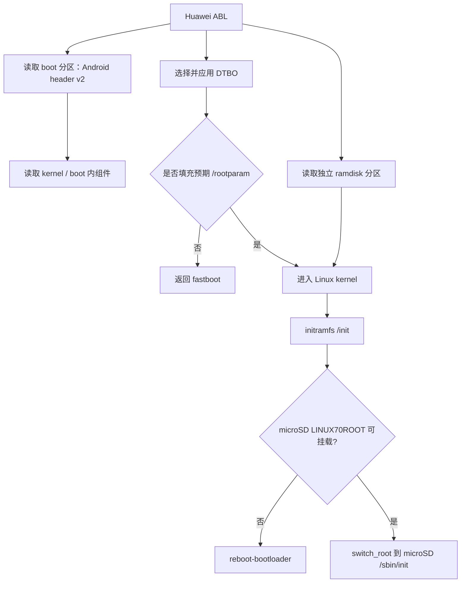
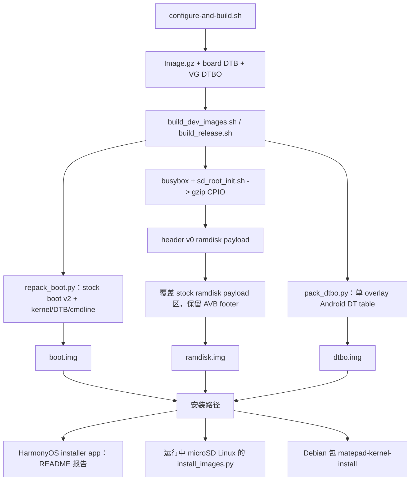

# Boot v2 repack、ABL 启动与安装路径分析

参考仓库冻结身份：`svesnav/linux-dby-w09` main，提交 `116cb1fe06110543ce03217e8bd8f35c12ca89c3`。本轮复核的关键 blob：README `3f7a18eb8a9ec7cf2917521ba4d694202f5b1200`、repack_boot.py `143c6f4c634a34cd2068ecd3c42cb471b8b832fb`、build_dev_images.sh `d1cbb590396f0cbb7bb229ece2fae8ebf12d2dd3`、install_images.py `38ba88276409c13d3da8291680071979fa19cc2e`、deb/matepad-kernel-install `8e494a0039ed54955fdde7452ba206ddd98d741a`、pack_dtbo.py `210f27355cf034c7cbe8313e4ca66e73dd4d15bc`。

## 1. ABL 实际启动链（公开项目可证范围）

README 第 35–49 行明确描述：Huawei ABL 启动 header v2 的 `boot`，ramdisk 从独立 `ramdisk` 分区加载；ABL 要求其应用的 DTBO 填充 `/rootparam`，否则设备返回 fastboot；该项目报告 `fastboot boot` 被拒绝。此为项目对 DBY-W09 的报告，不是本轮设备实测，也不应泛化到其他 Huawei 型号。

证据边界：
- README 37–49 行：ABL、boot v2、独立 ramdisk、DTBO/rootparam、fastboot boot 报告和 Linux SD-root 目的。
- sd_root_init.sh 1–5、24–30、55–80 行：initramfs 只为 Linux SD-root；找不到 ext4 标签 `LINUX70ROOT` 或挂载失败时转 fastboot，成功后 `switch_root /newroot /sbin/init`。
- ABL PE 的真实分支、DTBO selector、ramdisk 分区解析细节来自既有 Hybrid ABL/ROUND 报告，不是 svesnav 公开仓库源码。本文件不把 README 的概述伪装成 ABL 反汇编证据。

## 2. 构建、打包与安装路径

- configure-and-build.sh 第 1–5、约第 130–156 行：只在主机/WSL 构建，不联系设备；生成 Image.gz、板级 DTB、单独 DTBO。
- build_dev_images.sh 第 20–28 行：静态 busybox、`sd_root_init.sh`、reboot helper 组成 newc CPIO 并 gzip。
- build_dev_images.sh 第 30–52 行：空 kernel + gzip ramdisk 封装 header v0，page size 2048；检查 stock ramdisk 为 2 MiB 且尾部 64 字节窗口含 `AVBf`，按 footer 记录的 payload 边界覆盖并清零余隙，保留边界之后的 footer/tail。
- build_dev_images.sh 第 54–70 行：从 stock boot 重打包 kernel/DTB/cmdline；另行打包 VG overlay。
- README 第 8–12、114–121 行：HarmonyOS installer app 是独立仓库 `dby-w09-installer`；README 报告 app 会从 stock images 构建并安装三分区。本轮未获取/审计该 app 源码，不能断言其内部函数或 UI 行为。
- install_images.py 第 4–9、18–20、26–58 行：只允许 boot/ramdisk/dtbo；要求运行于 DBY-W09 Linux、根文件系统来自 microSD；检查镜像 SHA 和分区容量；逐项先备份完整分区，再写镜像、fsync，并只对写入长度做 SHA-256 读回；不自动重启。
- matepad-kernel-install 第 2–23、131–139、152–178、181–199、203–237 行：Debian 包安装器；构造三分区镜像；`--check` 只构建/比较不写；chroot/container/非 DBY-W09/microSD root 时拒绝写入；写前对需要改变的分区完整备份，之后写入、fsync、只校验镜像长度前缀。失败时提示手动从备份恢复，没有自动回滚。
- 首次安装：README 声称 HarmonyOS installer app 完成 stock image 保存和安装，但 app 源码不在本轮冻结文件中。后续运行中更新：install_images.py 或 matepad-kernel-install。不要把“构建镜像”与“写入设备”混为一谈。

## 3. 分区作用矩阵

| 分区 | svesnav Linux 方案用途 | 构造来源 | Android ACK 适配判断 |
|---|---|---|---|
| boot | 保留 stock header v2/原 boot 组件，替换 kernel、板级 DTB、Linux cmdline | stock boot + Image.gz + DTB + cmdline | 只研究保留 stock v2 并替换必要字段；本机 stock hash 不同，禁止套用公开脚本 guard |
| ramdisk | 独立 ramdisk 分区放 Linux SD-root header-v0 initramfs | busybox + sd_root_init.sh gzip CPIO 覆盖 stock payload 区，保留 footer | **不能照搬**；Android 需要保留 Huawei init/init.real，当前策略 KEEP_STOCK |
| dtbo | 单个 overlay 填充 `/rootparam` | `pack_dtbo.py` 单 Entry Android DT table | 公开 overlay 是 VG，不得用于 VD；保留 stock VD Entry 2 |

## 4. boot v2 重打包细节

### repack_boot.py

- 第 17–22 行：从 work area 的 `backups/boot.img` 读取 stock；固定 SHA-256 为 `6fb82f6c...`；`STOCK_PAYLOAD_SIZE=24,412,160`。
- 第 25–30、43–46 行：计算 stock SHA，并要求完整分区大小为 96 MiB。
- 第 54–63 行：调用 AOSP `unpack_bootimg.py --format=mkbootimg`；只接受 header version 2。
- 第 64–75 行：可替换 kernel、DTB、cmdline，再调用 `mkbootimg-android10.py`。
- 第 77–81 行：无 kernel 替换时验证重建的 stock boot payload 与原分区前 `STOCK_PAYLOAD_SIZE` 字节一致。
- 第 82–90 行：`--full-partition` 才会读取完整 stock 分区；要求新 payload 不超过 24,412,160 B，将新 payload 写入开头、把 payload 结束至该边界清零，边界之后的字节保留。该脚本没有独立解析/验证 AVB footer 元数据。

公开固定 stock SHA 与本机 live stock boot SHA `7a95c897c14a6f9151b6d22308b8086b8f6395d4bd9aa438faab126ae39d24a8` 不同，不能直接使用该脚本默认 hash guard。公开 24,412,160 B 是脚本的 payload 清零边界，不是分区容量。本机既有 boot-tail 审计记录 payload_end=24,449,024 B，比该边界多 36,864 B；本轮引用既有报告，未重新读取原始分区。PREP10 46,563,215 B 小于 96 MiB，只证明分区容量足够；它超过公开脚本的 24,412,160 B full-partition payload 限制。

### header v2 组件与 boot image ID

matepad-kernel-install 的 `boot_with()` 第 63–98 行：
- 第 64–72 行读取 Android magic、kernel/ramdisk/second 大小与地址、tags、page、version、OS version、name、recovery size/offset、DTB size/address，并要求 version=2。
- 第 73–80 行按 page 向上取整，依序定位 embedded ramdisk、second、recovery。
- 第 81–94 行重算 cmdline 与 header；SHA-1 对 kernel、ramdisk、second、recovery、DTB 按顺序逐个执行 `SHA1.update(component_bytes)` 后再追加该组件长度的 4-byte little-endian 表示；digest 放入 header 的 ID 区。
- 第 95–98 行按 page 对 header 和组件填充后输出。

这与 AOSP boot image ID 的组件/长度算法相符。boot v2 的 stock header 参数与 embedded ramdisk/second/recovery/DTB 会被保留或按重建参数写回；Android 适配仍必须用本机 stock header 做输入，不得以公开仓库另一份 stock image 替代。

## 5. DTBO table 格式边界

pack_dtbo.py 第 7–9、17–25 行：32-byte header、32-byte entry；`dt_offset=64`、count=1、page_size=4096，id/rev/custom 字段全 0。它只证明公开项目如何序列化单个 overlay，不证明 HOS4.3 ABL 接受相同 metadata。公开 overlay 的 board-id 0x206a，见 dby-w09-rootparam.dtso 第 16–28 行；它是 VG，不是本机 VD。

## 6. 安装器安全属性与局限

| 项目 | install_images.py | matepad-kernel-install |
|---|---|---|
| 目标分区 | 白名单 boot/ramdisk/dtbo | dtbo/ramdisk/boot |
| 机型/运行环境检查 | DBY-W09 kernel + microSD root | DBY-W09 model + microSD root；拒绝 chroot/container |
| 写前校验 | 输入文件 SHA、容量 | stock/bundle SHA、容量、待写前缀比较 |
| 写前备份 | 每个 job 读取完整分区 | 对所有需更改分区读取完整分区 |
| 写后读回 | 仅写入长度 | 仅写入长度 |
| 自动回滚 | 无 | 无；仅报错并提示手动恢复 |
| 原子事务 | 无；逐分区写 | 无；逐分区写，未提供跨分区事务回滚 |

因此“完整备份 + 写入前缀校验”不是完整的可自动恢复事务；若写入中途失败，需人工恢复。该事实不能作为本机 Android 分区写入授权或安全背书。

## 7. 结论

svesnav 证明同型号 DBY-W09 存在 Huawei ABL 直接分区启动 Linux 的公开实现，但其三分区内容是 Linux SD-root 方案。其 stock hash、payload boundary、Linux ramdisk 和 VG overlay 都不能直接移植到本机 VD + ACK Android。boot 分区容量算术通过不等于启动契约通过；ACK alignment 与 Android first-stage/bootconfig 仍未闭环，最终门禁维持 BLOCKED。
